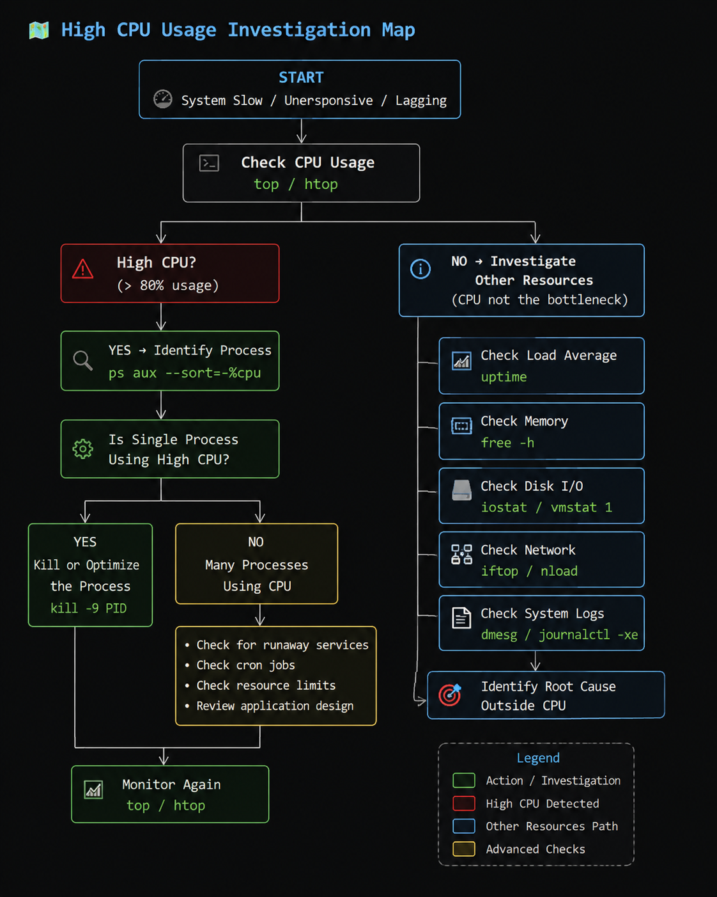

# CPU

## What It Is

The Central Processing Unit (CPU) is the main component responsible for executing instructions and processing data in a computer system.

It performs:
- calculations
- logical operations
- task execution
- process handling

The CPU is often referred to as: "the brain of the computer".

---

## Why It Matters

The CPU directly affects:
- system responsiveness
- multitasking capability
- virtualization performance
- application speed
- server workload handling

A slow or overloaded CPU can cause:
- lag
- delayed application response
- system bottlenecks
- high load average
- poor VM performance

---

## Linux Perspective

Linux interacts with the CPU through:
- the kernel scheduler
- process management
- interrupt handling
- system calls

Linux see CPUs as:
- logical processors
- schedulable execution units

CPU information is exposed through:
```
/proc/cpuinfo
/sys/devices/system/cpu/
```

Linux is responsible for:
- distribution workloads
- scheduling processes
- balancing CPU usage
- managing CPU time slices

---

## Mental Model

Think of the CPU like: "a restaurant kitchen":
- Processes = customer orders
- CPU cores = chefs
- Scheduler = manager assigning work
- Queue = waiting orders

If too many orders arrive:
- waiting time increases
- system slows down
- load average rises

---

## Architecture Flow

```
Application -> Process -> Linux Scheduler -> CPU Core -> Instruction Execution
```

---

## Commands
```bash
lscpu               # view CPU information
top                 # view cpu usage
htop                # view cpu usage
cat /proc/cpuinfo   # view processor details
mpstat              # monitor cpu statistics
uptime              # check system load
```

---

## Troubleshooting

### High CPU Usage



#### Symptoms

- system becomes slow
- Applications lag
- Fans spin loudly
- Delayed terminal response 

#### Common Checks

```bash
top                     # view highest cpu processes
ps aux --sort=-%cpu     # sort processes by cpu usage
uptime                  # check system load
sensors                 # check cpu temperature
```

#### Possible Causes

A runaway or CPU-intensive process is consuming excessive CPU resources.

Examples:
- infinite loops
- heavy compression tasks
- excessive parallel jobs
- poorly optimized applications

#### Resolution

Terminate (`kill -9 PID`) or optimize the process. 

Consider:
- reducing workload concurrency
- rescheduling heavy tasks
- adjusting process priorities

---

### High Load Average but Low CPU Usage

#### Symptoms

- system feels slow
- commands delay
- Applications freeze intermittently
- `top` shows relatively low CPU usage

#### Common Checks

```bash
uptime      # check load average
iostat      # check Disk IO wait
vmstat 1    # check Disk IO wait
```

#### Possible Causes

Processes are waiting on:
- storage
- disk operations
- blocked resources

Common Causes:
- slow HDD
- failing disk
- heavy database operations
- insufficient storage performance

### Resolution

Investigate:
- disk health
- storage latency
- filesystem performance

---

