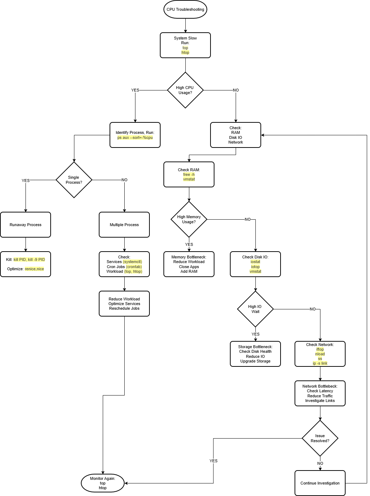

# CPU Troubleshooting

## Overview

CPU-related issues are one of the most common causes of:
- system slowness
- application lag
- poor virtualization performance
- server instability

However, high CPU usages does NOT always mean faulty CPU hardware.

In Linux systems, CPU problems are often caused by:
- runaway processes
- excessive workloads
- memory pressure
- storage bottlenecks
- network saturation
- thermal throttling

The goal of CPU troubleshooting is to:
1. Identify whether the CPU is truly the bottleneck
2. Determine what is consuming CPU resources
3. Investigate related system resources
4. Resolve the root causes
5. Verify system stability

---

## CPU Troubleshooting Flow



## Step 1 - Check CPU Usage

### Why

Before troubleshooting deeper, determine:
- whether CPU usage is actually high
- which processes are consuming resources
- whether the issue is system-wide or process-specific

---

### Commands

#### `top`

Purpose: Real-time system monitoring.

|Field|Meaning|
|---|---|
|%CPU|CPU usage by process|
|us|User CPU usage|
|sy|Kernel/system CPU usage|
|id|Idle CPU|
|wa|IO wait|
|load average|Overall workload|

---

#### `htop`

Purpose: Interactive process viewer.

| Area | Meaning |
|---|---|
| CPU bars | Per-core CPU usage |
| Mem bar | RAM usage |
| Swp bar | Swap usage |
| Tasks | Number of running processes/threads |
| Load average | System workload over 1, 5, and 15 minutes |
| Uptime | How long the system has been running |
| PID | Process ID |
| USER | Process owner |
| PRI / NI | Priority and nice value |
| VIRT | Total virtual memory used |
| RES | Actual physical RAM used |
| SHR | Shared memory |
| S | Process state |
| CPU% | CPU usage by process |
| MEM% | Memory usage by process |
| TIME+ | Total CPU time used |
| Command | Process command |

---

#### `top` vs `htop`

##### Similarities


| Feature | `top` | `htop` |
|---|---|---|
| Real-time CPU monitoring | Yes | Yes |
| Process monitoring | Yes | Yes |
| Memory monitoring | Yes | Yes |
| Load average display | Yes | Yes |
| View running processes | Yes | Yes |
| Detect high CPU usage | Yes | Yes |
| Sort processes | Yes | Yes |
| Troubleshooting tool | Yes | Yes |
| Available on Linux systems | Yes | Yes |

---

##### Differences

| Feature | `top` | `htop` |
|---|---|---|
| Interface | Basic text interface | Interactive colorful interface |
| Ease of use | More difficult | Easier to read |
| Mouse support | No | Yes |
| Scroll processes | Limited | Yes |
| Kill process interactively | Limited | Easy (`F9`) |
| Per-core CPU graph | Minimal | Visual CPU bars |
| Process tree view | No | Yes (`F5`) |
| Search/filter processes | Limited | Built-in (`F3`, `F4`) |
| Customization | Limited | Highly customizable |
| Installed by default | Usually yes | Often requires installation |
| Resource usage | Lower | Slightly higher |

---

### Identifying High CPU Usage (`top` / `htop`)

| Observation | Tool | Meaning | Possible Cause |
|---|---|---|---|
| Process using near 100% CPU | `top`, `htop` | Single process heavily consuming CPU | Runaway process, infinite loop, heavy workload |
| Multiple processes using high CPU | `top`, `htop` | Overall CPU workload saturation | Too many services, cron jobs, virtualization load |
| High `us` value | `top` | High user/application CPU usage | CPU-intensive applications |
| High `sy` value | `top` | High kernel/system CPU usage | Network processing, interrupts, firewall activity |
| Low `id` value | `top` | CPU has little idle time remaining | CPU saturation |
| High `wa` value | `top` | Processes waiting on storage | Disk IO bottleneck |
| One CPU core at 100% | `htop` | Single-thread bottleneck | Non-multithreaded application |
| All CPU cores heavily utilized | `htop` | Full CPU workload saturation | Heavy parallel processing |
| High load average | `top`, `htop`, `uptime` | System workload is high | CPU overload or resource waiting |
| High load average with low CPU usage | `top`, `htop` | CPU may not be bottleneck | Storage wait, blocked tasks |
| High `%steal` | `mpstat`, `top` | VM waiting for physical CPU time | Virtualization host contention |
| CPU temperature extremely high | `sensors` | Possible thermal throttling | Cooling issue, airflow problem |
| High interrupt activity | `/proc/interrupts` | CPU overloaded handling interrupts | NIC issue, packet flood, driver problem |
| System responsive but high CPU | `top`, `htop` | CPU busy but manageable | Normal heavy workload |
| System lagging/freezing with high CPU | `top`, `htop` | CPU unable to keep up | Severe overload or runaway process |

---

#### General CPU Usage Guidelines

| CPU Usage | Condition |
|---|---|
| 0–30% | Light workload |
| 30–70% | Normal workload |
| 70–90% | Heavy workload |
| 90–100% | Potential CPU bottleneck |

---

#### Load Average Guidelines

| Scenario | Interpretation |
|---|---|
| Load lower than core count | Usually healthy |
| Load near core count | CPU heavily utilized |
| Load much higher than core count | System overloaded |

---

## Step 2 - Investigate Multiple Processes

### Why 

If multiple processes are consuming CPU resources simultaneously:
- the issue may be caused by a single runaway process
- the system may be overloaded by overall workload demand

This commonly occurs due to:
- too many services running
- overlapping scheduled jobs
- virtualization workloads
- backups
- indexing tasks
- container orchestration
- excessive parallel processing

The goal is to determine:
- what workloads are contributing to CPU saturation
- whether the workload is expected or abnormal
- whether services or scheduled jobs should be optimized

---

### Commands

#### `ps aux --sort=-%cpu`

Purpose: Display processes sorted by highest CPU usage.

| Column | Meaning |
|---|---|
| USER | Process owner |
| PID | Process ID |
| %CPU | CPU usage |
| %MEM | Memory usage |
| COMMAND | Running command/process |

---

#### `systemctl`

Purpose: Manage and inspect systemd services and background processes.

Services are applications or processes that run in the background, such as:
- web servers
- databases
- SSH
- Docker
- monitoring agents

---

##### Common Commands

```bash
systemctl
```

View all loaded systemd units and their current states.

Useful for:
- getting a quick overview of active services
- identifying failed or running units

---

```bash
systemctl list-units --type=service
```

Display only service units currently loaded into systemd.

Useful for:
- identifying unnecessary running services
- checking how many services are active
- investigating background CPU usage

---

```bash
systemctl status service_name
```

Display detailed information about a specific service.

Example:

```bash
systemctl status apache2
```

Useful for:
- checking whether service is running
- viewing recent logs
- identifying service failures
- troubleshooting CPU-heavy services

---

```bash
systemctl stop service_name
```

Stop a running service immediately.

Example:

```bash
systemctl stop apache2
```

Useful when:
- service is consuming excessive CPU
- service becomes unresponsive
- temporary shutdown is required for troubleshooting

---

```bash
systemctl disable service_name
```

Prevent service from automatically starting during boot.

Example:

```bash
systemctl disable apache2
```

Useful for:
- disabling unnecessary services
- reducing background resource usage
- optimizing startup workload

---

##### Important Areas

| Area | Meaning |
|---|---|
| loaded | Service configuration successfully loaded |
| active | Current service state |
| running | Service actively operating |
| inactive | Service currently stopped |
| failed | Service encountered error/failure |
| enabled | Service starts automatically during boot |
| disabled | Service will not start automatically |
| Main PID | Main process ID of the service |
| Tasks | Number of processes/threads used |
| Memory | RAM consumed by service |
| CPU | CPU time consumed by service |

---

## Step 3 - Check RAM Usage

### Why

If CPU usage is NOT excessively high, system slowness may be caused by:
- insufficient memory
- excessive swapping
- memory pressure
- resource exhaustion

When RAM becomes heavily utilized, Linux may begin using `swap space`.

Swap is much slower than RAM because it uses storage devices instead of physical memory.

This may cause:
- severe slowdown
- application lag
- disk thrashing
- high load average
- delayed system response

The goal is to determine:
- whether memory is exhausted
- whether swap usage is excessive
- whether RAM pressure is causing indirect CPU or storage bottlenecks

---

### Commands

#### `free -h`

Purpose: Display system memory and swap usage in human-readable format.

---

##### Important Areas

| Field | Meaning |
|---|---|
| total | Total installed RAM |
| used | Currently used memory |
| free | Completely unused memory |
| shared | Shared memory usage |
| buff/cache | Memory used for buffers and filesystem cache |
| available | Estimated usable memory available |
| Swap | Swap space usage |

---

##### Why It Matters

Helps determine:
- whether RAM is exhausted
- whether swap is heavily utilized
- whether memory pressure exists

---

##### Important Linux Memory Concept

Linux intentionally uses RAM for:
- filesystem cache
- buffers
- performance optimization

Therefore:
- low `free` memory alone is NOT necessarily bad

The more important field is usually `available`.

---

##### Example

```text
Mem:
total:       16G
used:        14G
available:   500M
```

Possible indication:
- memory pressure
- limited remaining usable RAM

---

##### Swap Example

```text
Swap:
used: 8G
```

Possible indication:
- insufficient RAM
- active swapping
- performance degradation

---

#### `vmstat`

Purpose: Display system performance statistics for:
- memory
- CPU
- processes
- IO
- swapping

---

##### Continuous Monitoring: `vmstat 1`

Refreshes statistics every second.

---

##### Important Areas

| Field | Meaning |
|---|---|
| r | Runnable processes |
| b | Blocked processes |
| swpd | Swap memory used |
| free | Free memory |
| si | Swap in |
| so | Swap out |
| us | User CPU usage |
| sy | System CPU usage |
| id | Idle CPU |
| wa | IO wait |

---

##### Why It Matters

Helps identify:
- active swapping
- blocked processes
- memory pressure
- storage wait
- CPU/resource contention

---

##### Important Swap Indicators

| Observation | Meaning |
|---|---|
| High `si` | System reading from swap |
| High `so` | System writing to swap |
| Constant swap activity | Memory exhaustion |

---

##### Important IO Indicator

| Observation | Meaning |
|---|---|
| High `wa` | Processes waiting on storage |

This may indicate:
- storage bottleneck
- swap-related disk thrashing

---

### Identifying RAM Bottlenecks

| Observation | Tool | Meaning | Possible Cause |
|---|---|---|---|
| Very low available memory | `free -h` | Memory pressure | Excessive applications/services |
| High swap usage | `free -h` | RAM exhausted | Insufficient memory |
| Constant `si` / `so` activity | `vmstat` | Active swapping | Memory bottleneck |
| High `wa` values | `vmstat` | Storage wait | Swap thrashing |
| Many blocked processes (`b`) | `vmstat` | Processes waiting for resources | Resource contention |
| System freezes/lagging | `free -h`, `vmstat` | Severe memory pressure | Insufficient RAM |
| High memory usage across many processes | `top`, `htop` | Overall memory saturation | Excessive workload |

---

### Common Root Causes

| Cause | Description |
|---|---|
| Too many applications | Excessive memory consumption |
| Memory leaks | Applications not releasing RAM |
| Virtualization overload | Too many VMs consuming memory |
| Container overcommitment | Excessive container memory usage |
| Database workload | Heavy in-memory operations |
| Insufficient physical RAM | Hardware limitation |
| Excessive caching pressure | Large filesystem cache usage |

---

## General Troubleshooting Guidelines

| Observation | Recommended Action |
|---|---|
| High swap usage | Reduce workload or add RAM |
| Memory-heavy application | Optimize or restart application |
| Excessive services | Disable unnecessary services |
| Constant swap activity | Investigate memory exhaustion |
| High VM/container memory usage | Reduce allocations |

---

## Step 4 - Check Disk IO

### Why

If CPU usage and memory usage appear normal, system slowness may be caused by:
- storage bottlenecks
- excessive disk activity
- slow read/write operations
- disk wait time
- failing storage devices

Linux systems often appear slow when processes are `waiting on storage operations`.

In this situation:
- CPU may actually be idle
- but applications still become unresponsive

This is known as `IO wait`.

The goal is to determine:
- whether storage is overloaded
- whether processes are waiting for disk operations
- whether storage performance is causing system slowdown

---

### Commands

#### `iostat`

```bash
iostat  # display CPU and diso IO statistics
iostat1 # refresh statistics every second
```

##### Important Areas

| Field | Meaning |
|---|---|
| %util | Disk utilization percentage |
| await | Average IO wait time |
| r/s | Read operations per second |
| w/s | Write operations per second |
| rkB/s | Read throughput |
| wkB/s | Write throughput |

---

##### Why It Matters

Helps determine:
- whether disks are overloaded
- whether storage latency is high
- whether applications are waiting for storage

---

##### Important Indicators

| Observation | Meaning |
|---|---|
| High `%util` | Disk heavily utilized |
| High `await` | Slow disk response time |
| High read/write activity | Heavy IO workload |

---

#### `iotop`

Purpose: Display processes performing disk IO activity. (Requires root access)

---

##### Important Areas

| Field | Meaning |
|---|---|
| DISK READ | Disk read activity |
| DISK WRITE | Disk write activity |
| IO% | IO usage percentage |
| SWAPIN | Swap-related disk activity |
| COMMAND | Process generating IO |

---

##### Why It Matters

Helps identify:
- applications causing excessive disk activity
- heavy database workloads
- backup operations
- logging activity
- swap thrashing

---

#### `vmstat`

Purpose: Display system-wide performance statistics.

---

##### Important Areas

| Field | Meaning |
|---|---|
| wa | CPU waiting on IO |
| bi | Blocks received from disk |
| bo | Blocks sent to disk |
| b | Blocked processes |

---

##### Why It Matters

High `wa` values indicate:
- processes waiting for storage operations
- potential storage bottlenecks

---

##### Important Linux Insight

High load average with:
- low CPU usage
AND
- high `wa`

often indicates `storage bottleneck rather than CPU bottleneck`.

---

#### `lsblk`

Purpose: Display block storage devices.

---


##### Why It Matters

Helps identify:
- available disks
- partitions
- mounted filesystems
- storage layout
- affected storage devices

Useful during disk IO troubleshooting because:
- applications may slow down due to specific disks or partitions
- storage bottlenecks are often tied to particular mount points
- helps correlate workloads with physical storage devices

---

##### Important Areas

| Field | Meaning |
|---|---|
| NAME | Device or partition name |
| SIZE | Storage size |
| TYPE | Disk, partition, LVM, loop device |
| MOUNTPOINT | Mounted filesystem location |

---

#### `df -h`

Purpose: Display filesystem disk usage.

```bash
df -h
```

---

##### Important Areas

| Field | Meaning |
|---|---|
| Size | Filesystem size |
| Used | Space used |
| Avail | Available space |
| Use% | Percentage used |
| Mounted on | Mount location |

---

##### Why It Matters

A filesystem near `100%` may cause:
- application failures
- write delays
- logging problems
- severe performance issues

---

### Identifying Disk IO Bottlenecks

| Observation | Tool | Meaning | Possible Cause |
|---|---|---|---|
| High `%util` | `iostat` | Disk fully utilized | Heavy workload |
| High `await` | `iostat` | Slow storage response | Slow/failing disk |
| High `wa` values | `vmstat` | CPU waiting on storage | IO bottleneck |
| Excessive read/write activity | `iotop` | Heavy disk workload | Backup/database activity |
| Many blocked processes | `vmstat` | Processes waiting for IO | Storage congestion |
| Filesystem near 100% full | `df -h` | Storage exhaustion | Disk capacity issue |
| System slow with low CPU usage | `vmstat`, `iostat` | Processes blocked on IO | Disk bottleneck |
| High swap-related IO | `iotop`, `vmstat` | Memory pressure affecting disk | Swap thrashing |

---

### Common Root Causes

| Cause | Description |
|---|---|
| Slow HDD | Mechanical storage limitations |
| Failing SSD/HDD | Storage degradation |
| Excessive logging | High write workload |
| Backup operations | Heavy sequential IO |
| Database workload | Large read/write operations |
| Swap thrashing | Insufficient RAM causing excessive swapping |
| Full filesystem | Disk nearly out of space |
| Virtualization storage contention | Multiple VMs sharing storage |

---

## Step 5 - Check Network

### Why

If CPU, memory, and storage appear healthy, system slowness may be caused by:
- network congestion
- excessive traffic
- high latency
- packet loss
- network saturation
- abnormal connections

Network-related issues may also indirectly increase CPU usage due to:
- packet processing
- interrupt handling
- firewall activity
- encryption overhead
- excessive socket connections

The goal is to determine:
- whether the network is reachable
- whether bandwidth is saturated
- whether abnormal traffic exists
- whether network activity is contributing to system slowdown

---

#### `ping`

Purpose: Test basic network connectivity and latency.

```bash
ping 8.8.8.8
```

---

##### Important Areas

| Observation | Meaning |
|---|---|
| replies received | Network reachable |
| high ms values | High latency |
| packet loss | Network instability |
| no response | Connectivity issue |

---

##### Why It Matters

Helps determine:
- whether network connectivity exists
- whether latency is abnormal
- whether packet loss is occurring

---

#### `ip a`

Purpose: Display network interfaces and IP addresses.

```bash
ip a
```

---

##### Important Areas

| Field | Meaning |
|---|---|
| UP | Interface active |
| DOWN | Interface inactive |
| inet | IPv4 address |
| state UP | Interface operational |

---

##### Why It Matters

Helps identify:
- missing IP addresses
- disabled interfaces
- disconnected adapters
- incorrect interface configuration

---

#### `iftop`

Purpose: Display real-time bandwidth usage per connection.

```bash
sudo iftop
```

---

##### Important Areas

| Area | Meaning |
|---|---|
| TX | Outgoing traffic |
| RX | Incoming traffic |
| connection list | Active network connections |
| bandwidth usage | Real-time traffic consumption |

---

##### Why It Matters

Helps identify:
- bandwidth saturation
- abnormal traffic spikes
- unexpected network activity
- high-traffic connections

---

#### `nload`

Purpose: Display network throughput visualization.

```bash
nload
```

---

##### Important Areas

| Area | Meaning |
|---|---|
| Incoming | Download traffic |
| Outgoing | Upload traffic |
| Current traffic | Real-time bandwidth |
| Average traffic | Average network usage |

---

##### Why It Matters

Helps identify:
- sustained heavy traffic
- network congestion
- unusual bandwidth usage

---

#### `ss -tulnp`

Purpose: Display listening ports and active network sockets.

```bash
ss -tulnp
```

---

##### Important Areas

| Field | Meaning |
|---|---|
| tcp / udp | Connection protocol |
| LISTEN | Service waiting for connections |
| Local Address | Local listening address |
| Peer Address | Remote endpoint |
| Process | Process using socket |

---

##### Why It Matters

Helps identify:
- excessive network connections
- suspicious listening services
- overloaded applications
- unexpected open ports

---

#### `ip -s link`

Purpose: Display interface statistics and network errors.

```bash
ip -s link
```

---

##### Important Areas

| Field | Meaning |
|---|---|
| RX | Received packets |
| TX | Transmitted packets |
| dropped | Dropped packets |
| errors | Interface errors |
| overruns | Buffer overflow conditions |

---

##### Why It Matters

Helps identify:
- packet drops
- network interface problems
- driver issues
- overloaded interfaces

---

### Identifying Network Bottlenecks

| Observation | Tool | Meaning | Possible Cause |
|---|---|---|---|
| High latency | `ping` | Slow network response | Congestion or routing issue |
| Packet loss | `ping` | Network instability | Poor connection or overload |
| High bandwidth usage | `iftop`, `nload` | Network saturation | Heavy downloads/uploads |
| Excessive active connections | `ss -tulnp` | Socket overload | Traffic spikes or attacks |
| Large RX/TX traffic | `iftop`, `nload` | Heavy network workload | Streaming, backups, replication |
| Dropped packets | `ip -s link` | Interface unable to keep up | NIC overload |
| High interrupt activity | `/proc/interrupts` | CPU processing excessive packets | Interrupt storm |
| High `%sy` CPU usage | `top` | Kernel networking overhead | Packet processing |
| Slow application response | `ping`, `ss` | Network delay | Congestion or latency |
| Network interface DOWN | `ip a` | Interface inactive | Cable/adapter issue |

---

### Common Root Causes

| Cause | Description |
|---|---|
| Network congestion | Excessive traffic volume |
| Packet flood/DDoS | Abnormal inbound traffic |
| High bandwidth usage | Heavy transfers or backups |
| Faulty NIC | Hardware/network adapter issue |
| Driver problems | NIC driver instability |
| Firewall overload | Excessive packet filtering |
| VPN encryption overhead | CPU-heavy encryption processing |
| Excessive socket connections | Application overload |
| Routing issue | Incorrect network path |
| Interface misconfiguration | Incorrect IP/gateway setup |

---

### Resolution Commands

#### Restart Network Interface

```bash
sudo ip link set eth0 down
sudo ip link set eth0 up
```

Purpose:
- reset problematic interface

---

#### Restart Network Service

```bash
sudo systemctl restart NetworkManager
```

Purpose:
- reload network configuration

---

#### Stop Problematic Service

```bash
systemctl stop service_name
```

Purpose:
- stop applications generating excessive traffic

---

#### Block Suspicious Connections

```bash
sudo ufw deny from IP_ADDRESS
```

Purpose:
- block abusive or suspicious traffic

---

### Why These Commands Are Used

| Command | Purpose |
|---|---|
| ip link set | Reset network interface |
| systemctl restart | Restart network services |
| systemctl stop | Stop traffic-heavy service |
| ufw deny | Block suspicious traffic |

---

### General Troubleshooting Guidelines

| Observation | Recommended Action |
|---|---|
| High bandwidth usage | Investigate traffic source |
| Excessive connections | Check applications/services |
| Packet drops | Investigate NIC or congestion |
| High latency | Check routing and network load |
| High `%sy` CPU usage | Investigate packet processing |
| Suspicious traffic | Block or rate-limit connections |
| Interface DOWN | Check cable/NIC configuration |

---

