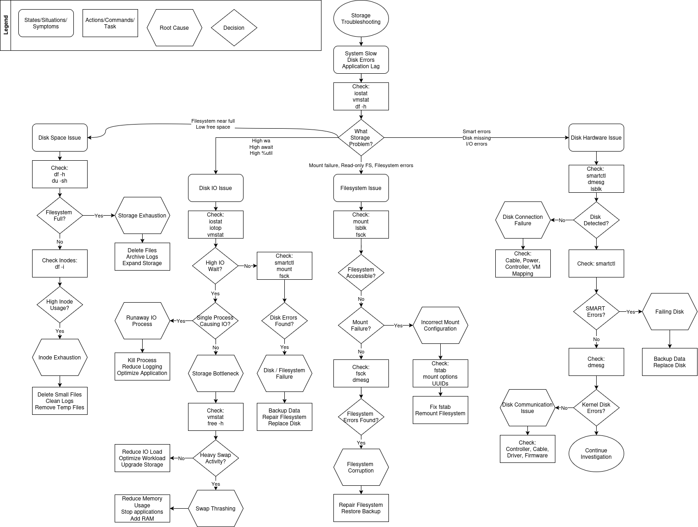

# Storage Troubleshooting

## Overview

Storage troubleshooting in Linux involves identifying and resolving issues related to:
- disk space
- disk performance
- filesystems
- storage hardware
- mount failures
- swap activity

Storage problems can cause:
- system slowness
- application lag
- boot failures
- read-only filesystems
- corrupted data
- high load average
- blocked processes

Unlike CPU issues, storage issues often cause `processes waiting for resources` rather than actively consuming CPU time.

---

## Goals of Storage Troubleshooting

The goal is to:

1. Identify whether storage is the bottleneck
2. Determine the type of storage issue
3. Investigate the root cause
4. Resolve the issue safely
5. Verify filesystem and storage stability

---

## Storage Troubleshooting Flow

---

## Step 1 - Initial Storage Investigation

### Why

Before troubleshooting deeper, determine:
- whether storage is involved
- whether the system is waiting on IO
- whether filesystems are full
- whether blocked processes exist

The purpose of the initial investigation is to narrow the troubleshooting direction.

---

### Commands

#### `iostat` - Display disk IO and CPU statistics

| Field | Meaning |
|---|---|
| %util | Disk utilization percentage |
| await | Average IO response time |
| r/s | Reads per second |
| w/s | Writes per second |

---

##### Why It Matters

Helps determine:
- whether disks are overloaded
- whether storage latency exists
- whether storage devices are saturated
---

#### `vmstat` - Display system performance statistics

| Field | Meaning |
|---|---|
| wa | CPU waiting on IO |
| b | Blocked processes |
| si/so | Swap activity |

---

##### Why It Matters

Helps determine:
- whether processes are waiting on storage
- whether swap activity exists
- whether storage bottlenecks affect the system

---

#### `df -h` - Display filesystem disk usage.

| Field | Meaning |
|---|---|
| Size | Filesystem size |
| Used | Used storage |
| Avail | Available storage |
| Use% | Filesystem utilization percentage |
| Mounted on | Mount point |

---

##### Why It Matters

Helps identify:
- full filesystems
- storage exhaustion
- low available storage

---

## Initial Investigation Interpretation

| Observation | Possible Direction |
|---|---|
| Filesystem nearly full | Disk Space Issue |
| High `wa` values | Disk IO Issue |
| High `await` or `%util` | Storage bottleneck |
| Mount/access issues | Filesystem Issue |
| Disk missing or IO errors | Disk Hardware Issue |

---

## Step 2 - Disk Space Issue

### Why

Filesystems that are nearly full can cause:
- application failures
- write failures
- logging issues
- package installation failures
- system instability

Linux systems may also run out of `inodes` even when disk space still exists.

---

### Commands

* `df -h` - Check filesystem usage
* `du -sh` - Find large directories and files

---

### Important Linux Concept - Inodes

Linux filesystems use `inodes` to track files.

A filesystem may still have free space **BUT** be unable to create files if `all inodes are consumed`.

This commonly occurs with:
- log spam
- mail queues
- temporary files
- millions of tiny files

---

#### `df -i` - Check inode usage

| Field | Meaning |
|---|---|
| IUsed | Used inodes |
| IFree | Free inodes |
| IUse% | Inode usage percentage |

---

#### Identifying Disk Space Problems

| Observation | Meaning | Possible Cause |
|---|---|---|
| Filesystem near 100% | Storage exhaustion | Logs, backups, large files |
| High inode usage | Inode exhaustion | Excessive small files |
| No free storage | Applications may fail | Capacity exhaustion |
| Unable to create files | Inodes exhausted | File count limit reached |

---

#### Root Causes

| Root Cause | Description |
|---|---|
| Storage Exhaustion | Filesystem completely full |
| Inode Exhaustion | Filesystem ran out of inodes |

---

#### Resolution Actions

| Action | Purpose |
|---|---|
| Delete files | Free storage space |
| Archive logs | Reduce storage usage |
| Remove temp files | Reduce inode usage |
| Expand storage | Increase capacity |

---

## Step 3 - Disk IO Issue

### Why

Disk IO issues occur when:
- storage cannot keep up with workload demand
- processes wait on disk operations
- swap activity increases disk pressure

Disk IO bottlenecks often cause:
- slow applications
- high load average
- blocked processes
- system lag

---

### Commands

* `iostat` - Monitor disk IO performance
* `iotop` - display processes performing disk IO.
* `vmstat` - monitor blocked processes and swap activity

#### Why `iotop` Requires Root Access

`iotop` reads:
- kernel IO accounting information
- per-process disk activity

This requires elevated privileges because Linux restricts access to:
- kernel statistics
- process accounting data

---

### Important Linux Concept - IO Wait (`wa`)

`wa` values indicate processes waiting on storage **NOT** actively using CPU.

This is one of the most important Linux troubleshooting concepts.

---

### Identifying Disk IO Problems

| Observation | Meaning | Possible Cause |
|---|---|---|
| High `%util` | Disk fully utilized | Heavy workload |
| High `await` | Slow storage response | Slow/failing storage |
| High `wa` | CPU waiting on storage | IO bottleneck |
| High IO process activity | Excessive disk workload | Logging/database activity |
| High swap activity | Memory pressure affecting storage | Swap thrashing |

---

### Important Linux Concept - Swap Thrashing

Swap thrashing occurs when:
- RAM becomes exhausted
- Linux aggressively swaps memory pages to disk

This creates:
- heavy disk IO
- severe performance degradation
- blocked processes

---

### Root Causes

| Root Cause | Description |
|---|---|
| Storage Bottleneck | Disk unable to keep up |
| Runaway IO Process | Single process generating excessive IO |
| Swap Thrashing | Excessive swapping due to low RAM |

---

### Resolution Actions

| Action | Purpose |
|---|---|
| Reduce IO workload | Lower storage pressure |
| Optimize applications | Reduce excessive writes |
| Stop problematic process | Remove runaway IO |
| Add RAM | Reduce swap usage |
| Upgrade storage | Improve performance |

---

## Step 4 - Filesystem Issue

### Why

Filesystem issues can cause:
- inaccessible storage
- boot failures
- read-only filesystems
- corrupted data
- application crashes

Filesystem problems do **NOT** always mean disk hardware failure.

Sometimes the issue is:
- incorrect mount configuration
- filesystem corruption
- UUID mismatch
- unclean shutdown

---

### Commands

- `mount` - display mounted filesystems
- `lsblk` - display block devices and mount points
- `fsck` - check and repair filesystem consistency

---

### Important Linux Concept - `/etc/fstab`

Linux uses `text /etc/fstab` to define persistent filesystem mounts.

Incorrect:
- UUIDs
- mount points
- mount options

may prevent Linux from booting.

---

### Identifying Filesystem Problems

| Observation | Meaning | Possible Cause |
|---|---|---|
| Mount failure | Filesystem cannot mount | Incorrect fstab |
| Read-only filesystem | Filesystem protection mode | Corruption |
| Filesystem errors | Filesystem inconsistency | Unclean shutdown |
| Missing mount point | Storage inaccessible | Configuration issue |

---

### Root Causes

| Root Cause | Description |
|---|---|
| Incorrect Mount Configuration | Broken mount settings |
| Filesystem Corruption | Filesystem inconsistency/damage |

---

### Resolution Actions

| Action | Purpose |
|---|---|
| Fix fstab | Correct mount configuration |
| Remount filesystem | Restore accessibility |
| Repair filesystem | Restore filesystem integrity |
| Restore backup | Recover corrupted data |

---

## Step 5 - Disk Hardware Issue

### Why

Disk hardware issues involve:
- failing SSDs/HDDs
- communication failures
- bad sectors
- hardware degradation
- controller problems

Hardware issues may cause:
- IO errors
- filesystem corruption
- disappearing disks
- boot failures
- kernel disk errors

---

### Commands

* `smartctl` - Display SMART disk health information.
* `dmesg` - Display kernel hardware and disk errors.
* `lsblk` - Verify disk detection and visibility.

---

### Important Linux Concept - SMART Monitoring

SMART (Self-Monitoring, Analysis and Reporting Technology) allows disks to report:
- health status
- bad sectors
- pending failures
- hardware degradation

---

### Identifying Disk Hardware Problems

| Observation | Meaning | Possible Cause |
|---|---|---|
| Disk missing | Device not detected | Cable/controller issue |
| SMART errors | Disk degradation | Failing storage device |
| Kernel IO errors | Communication failure | Controller/cable issue |
| Frequent disk resets | Hardware instability | Firmware or power issue |

---

### Root Causes

| Root Cause | Description |
|---|---|
| Failing Disk | Physical storage degradation |
| Disk Communication Issue | Cable/controller/driver issue |
| Disk Connection Failure | Device not properly connected |

---

### Resolution Actions

| Action | Purpose |
|---|---|
| Backup data | Prevent data loss |
| Replace disk | Remove failing hardware |
| Check cables | Verify physical connections |
| Update firmware | Resolve firmware instability |
| Check controller/driver | Resolve communication issues |

---

## Important Linux Troubleshooting Insights

| Insight | Meaning |
|---|---|
| High load average does not always mean CPU issue | Processes may be waiting on storage |
| High `wa` values indicate IO wait | Storage may be bottleneck |
| Full filesystem does not always mean no storage | Inodes may be exhausted |
| Filesystem issue does not always mean hardware failure | Configuration/corruption may exist |
| SMART healthy does not guarantee no issue | Cable/controller problems may still exist |

---

## Quick Recall

| Problem | Possible Cause |
|---|---|
| Filesystem full | Storage exhaustion |
| Cannot create files with free space available | Inode exhaustion |
| High `wa` values | Disk IO bottleneck |
| Heavy swap activity | Swap thrashing |
| Mount failure | Incorrect fstab |
| Read-only filesystem | Filesystem corruption |
| SMART errors | Failing disk |
| Disk missing | Connection/controller issue |
| Kernel disk errors | Communication issue |